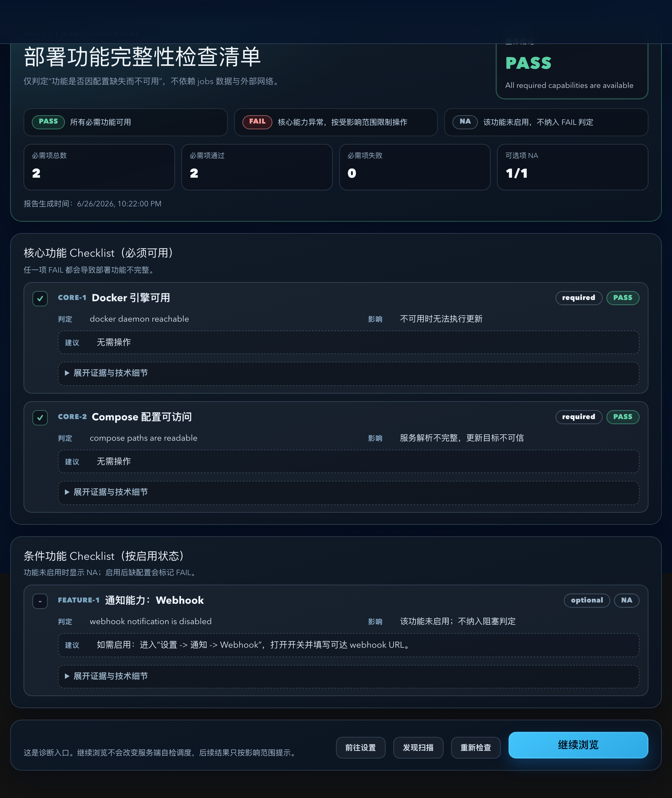
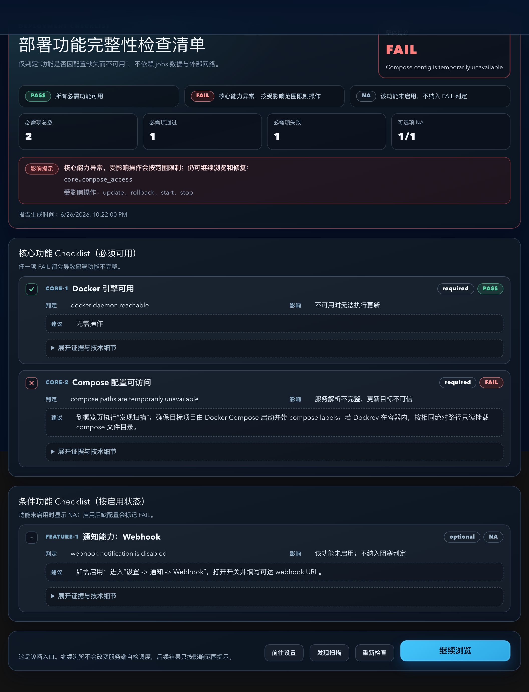
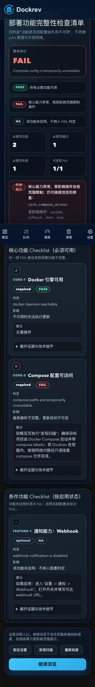

# Dockrev：服务端自主自检与无阻塞网页入口

> 本文是服务端自检生命周期、报告契约和网页展示边界的长期行为合同。实现覆盖见 `IMPLEMENTATION.md`，主题历史与兼容背景见 `HISTORY.md`。

## Context and Scope

- Context: 部署自检是服务运行能力与可选集成功能的诊断来源。服务端必须拥有调度和结论，网页只读取结果并按实际影响展示。
- In scope: 启动自检、五分钟后台复查、相关输入变化合并、报告元数据、核心故障投影、操作影响投影、无阻塞入口、跨标签页自动展示去重和诊断页修复入口。
- Out of scope: 身份鉴权规则、Supervisor 自升级流程、既有更新安全检查、外部监控服务、数据库表结构迁移和整站视觉重做。

## Terms and Interfaces

- `server boot`: 服务端一次连续运行实例，由 `serverBootId` 标识。
- `startup report`: 当前服务端启动后完成的首轮自检结论；旧启动报告只能作为历史诊断参考。
- `core failure`: 会影响一个或多个核心运维能力的已确认故障，可产生 `startupFailureKey` 和操作影响投影。
- `feature failure`: 邮件、Telegram、GitHub 等可选功能的故障，只在对应功能或设置处提示。
- `operation impact`: 一个检查项对操作、对象范围和原因的结构化投影；它不替代操作执行边界的实时前置校验。
- `GET /api/deploy-check/report`: 只读当前快照；读取、刷新前台、恢复前台和事件重连不得排入自检。
- `POST /api/deploy-check/report/refresh`: 明确的手动复查请求；只异步排队并立即返回状态。

## Interfaces

| Interface | Kind | Change | Contract |
| --- | --- | --- | --- |
| `GET /api/deploy-check/report` | HTTP API | Extend, read-only | `serverBootId`, `reportBootId`, `reportRevision`, `startupStatus`, `startupFailureKey` and `operationImpacts` are additive and optional for old snapshots. |
| `POST /api/deploy-check/report/refresh` | HTTP API | Preserve, clarify | Explicit manual refresh only; enqueue and return without synchronously building a report. |
| `deploy_check` management event | Event | Extend | Completion, recovery and abnormal termination publish a re-readable status summary. |
| deploy check snapshot JSON | Persistent state | Extend | Metadata is embedded in existing report JSON; old snapshots remain readable and are never treated as current-startup completion. |
| browser auto-open claim store | Browser state | New | IndexedDB transaction claims one `(deployment path, startup failure key)` automatic diagnostic display across same-origin tabs. |

## Requirements

### REQ-SCS-001

- The server MUST enqueue one self-check after startup discovery has returned, even when discovery reports an error; the HTTP listener MUST become available without awaiting the check result.
- The server MUST run a scheduled review every 300 seconds and MUST coalesce relevant settings and discovery input changes into one pending review.
- At most one review MAY execute at a time. An input change received during execution MUST cause a follow-up review that covers the newest input.
- Browser opens, reloads, new tabs, foreground recovery and event-stream reconnection MUST NOT schedule a review.

### REQ-SCS-002

- Static failures MAY be confirmed immediately. Command timeouts and runtime connection failures MUST receive one bounded retry after two seconds, with a maximum review budget of 30 seconds and existing per-command timeout settings preserved.
- A successful retry MUST suppress the transient failure. A review-level error MUST preserve the last confirmed report and expose the check error separately.
- A successful discovery with no managed project MUST NOT classify Compose paths as a core failure solely because no path exists to inspect.

### REQ-SCS-003

- The report MUST retain the complete diagnostic check list and overall summary while exposing independent startup and operation projections.
- `operationImpacts` MUST identify the check, affected operation set, object scope or IDs when known, and a human-readable reason.
- Docker engine failures MAY affect Docker-dependent update, rollback, lifecycle and cleanup operations; Compose executor failures MAY affect only Compose operations; path and image-reference failures MUST be scoped to associated projects or services.
- Optional notification, GitHub and repository configuration failures MUST NOT make core startup status fail and MUST NOT disable unrelated update or lifecycle operations.
- The server MUST continue to validate actual prerequisites at each operation boundary. A cached PASS MUST NOT authorize an operation and a cached FAIL MUST NOT be the sole reason to reject an unrelated operation.

### REQ-SCS-004

- GET MUST only read the latest snapshot and return pending, ready or error information without enqueuing work.
- POST MUST only represent an explicit manual recheck and MUST enqueue asynchronously.
- The response MUST preserve existing `pending`/`ready` fields and remain readable by older consumers when the additive fields are absent.
- Reports MUST identify `serverBootId`, `reportBootId`, completion revision and startup status. An old report MUST NOT count as this boot's completed startup report.
- Auth checks remain per-request authorization diagnostics and MUST NOT change the deployment-wide startup conclusion.

### REQ-SCS-005

- The first entry read MAY automatically show the diagnostic page only when it reads a current-boot, confirmed core startup failure.
- A pending response, read error, old report or a late first result MUST close the entry's automatic-display opportunity; the current page MUST remain visible.
- A healthy, pending or unreadable report MUST immediately render the target page without a full-page self-check wait, global loading mask, success welcome page or all-operation lock.
- Background failure, recovery and review events MUST update a compact notice and scoped operation state while retaining the current page.

### REQ-SCS-006

- The diagnostic page MUST provide the cause, scope, impact, repair or settings/discovery entry, manual recheck and a continue-browsing action.
- Operation restrictions MUST follow `operationImpacts`; browsing, settings, discovery, diagnostics and repair paths MUST remain reachable.
- Optional feature failures MUST be shown locally and MUST clear when the feature recovers.
- Manual recheck feedback MUST be local to the diagnostic action and MAY wait for event or `retryAfterMs` bounded reads for at most 35 seconds; it MUST NOT trigger a new check from GET or a site-wide loading state.

### REQ-SCS-007

- For one server boot and one continuing startup failure, the same browser MUST claim automatic display at most once using an atomic same-origin IndexedDB transaction keyed by deployment path and failure key.
- After continue browsing, reloads and new same-origin tabs MUST retain notices and scoped restrictions without forcing the diagnostic route again.
- If browser storage is unavailable, the client MUST prefer a notice and explicit diagnostic link over forced navigation.
- A later failure after a healthy startup MUST NOT receive the startup auto-display privilege. Recovery MUST clear the active startup failure key and corresponding impacts without redirecting the user.

## Verification

### VER-SCS-001

- Method: Backend virtual-clock and controlled-runner tests.
- covers: `REQ-SCS-001`, `REQ-SCS-002`
- Pass condition: Startup runs without a browser, five-minute reviews run, unchanged scans do not add runs, changes coalesce, in-flight changes are not lost, concurrency is one, and retry/error budgets are bounded.

### VER-SCS-002

- Method: API and historical-snapshot compatibility tests.
- covers: `REQ-SCS-003`, `REQ-SCS-004`
- Pass condition: GET never runs commands or schedules work, explicit POST queues asynchronously, old and missing snapshots remain readable, additive fields do not break old consumers, and error completion emits a re-readable event.

### VER-SCS-003

- Method: Controlled mock-only browser tests with same-origin tabs and request logs.
- covers: `REQ-SCS-005`, `REQ-SCS-007`
- Pass condition: Healthy, pending and error entries render the target page with zero automatic POSTs; one current startup failure claims at most one diagnostic route; late/background failures only notify; recovery only rereads state; refresh and new tabs do not repeat navigation.

### VER-SCS-004

- Method: Backend operation regression and frontend interaction tests.
- covers: `REQ-SCS-003`, `REQ-SCS-006`
- Pass condition: Optional feature failures do not restrict core operations, object-scoped failures do not restrict unrelated objects, diagnosis and repair stay reachable, and live operation checks remain authoritative.

### VER-SCS-005

- Method: `ui_demo` and Storybook mock-only evidence at desktop and 393x852 CSS-pixel viewports plus web lint/build.
- covers: `REQ-SCS-005`, `REQ-SCS-006`
- Pass condition: No full-page self-check wait or horizontal overflow appears; the diagnostic page offers continue and repair paths; compact failure notices and local restrictions remain readable.

## Visual Evidence

- source_type: `storybook_canvas`
  target_program: `mock-only`
  capture_scope: `page`
  requested_viewport: `1440x900 CSS px`
  viewport_strategy: `storybook-viewport`
  margin_policy: `trim_only`
  evidence_surface: `page`
  sensitive_exclusion: `N/A`
  submission_gate: `owner-approved`
  evidence_binding_sha: `ba6cdac9d1abbdc4edc0ab1acb0784d64fe1d4ca`
  story_id_or_title: `Pages/DeployWelcomePage/Default`
  state: `healthy report renders without a blocking wait`
  evidence_note: 本地 mock-only Storybook 证据；入口直接展示诊断清单与继续浏览入口，网页读取不排入服务端自检。

- source_type: `storybook_canvas`
  target_program: `mock-only`
  capture_scope: `page`
  requested_viewport: `1440x900 CSS px`
  viewport_strategy: `storybook-viewport`
  margin_policy: `trim_only`
  evidence_surface: `page`
  sensitive_exclusion: `N/A`
  submission_gate: `owner-approved`
  evidence_binding_sha: `ba6cdac9d1abbdc4edc0ab1acb0784d64fe1d4ca`
  story_id_or_title: `Pages/DeployWelcomePage/CoreFailureDiagnostic`
  state: `core failure keeps scoped diagnosis, repair and continue browsing reachable`
  evidence_note: 本地 mock-only Storybook 证据；核心故障只提示受影响操作，不再显示 BLOCKING 门禁或整页等待。

- source_type: `storybook_canvas`
  target_program: `mock-only`
  capture_scope: `page`
  requested_viewport: `393x852 CSS px`
  viewport_strategy: `storybook-viewport`
  margin_policy: `trim_only`
  evidence_surface: `page`
  sensitive_exclusion: `N/A`
  submission_gate: `owner-approved`
  evidence_binding_sha: `ba6cdac9d1abbdc4edc0ab1acb0784d64fe1d4ca`
  story_id_or_title: `Pages/DeployWelcomePage/BlockedCoreFailureMobile`
  state: `core failure diagnosis stays readable on mobile`
  evidence_note: 本地 mock-only Storybook 证据；393x852 下故障提示、修复入口和继续浏览按钮无横向溢出或重叠。

## Related ADRs

- [ADR 0016：服务端拥有自检生命周期，网页按实际影响展示结果](../../adr/0016-server-owned-self-checks.md)
